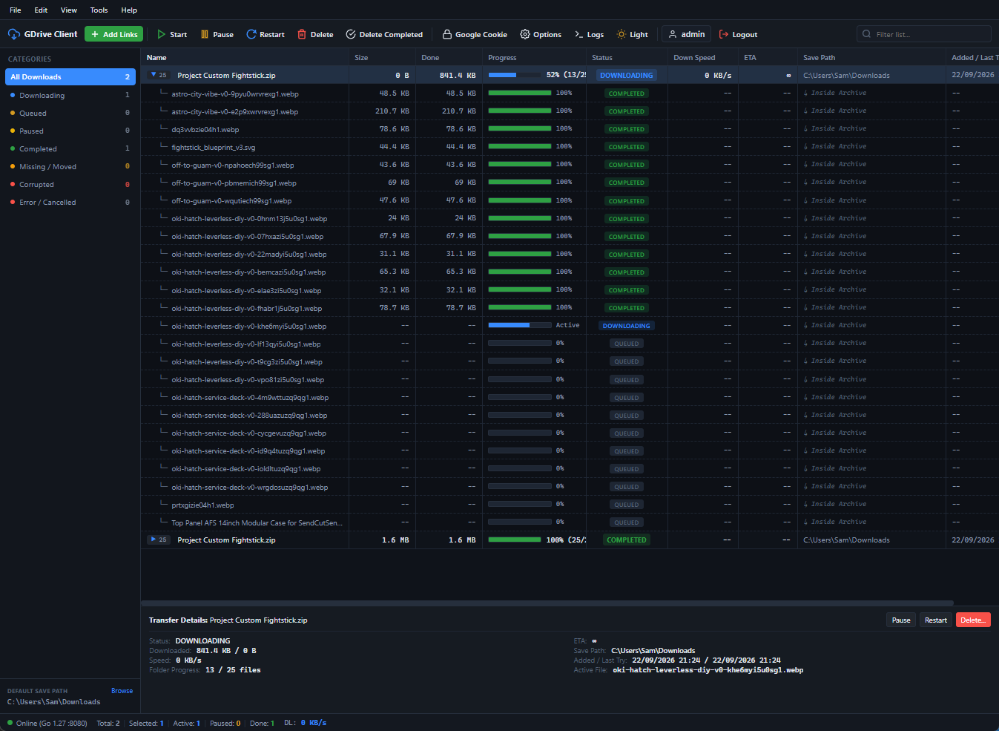
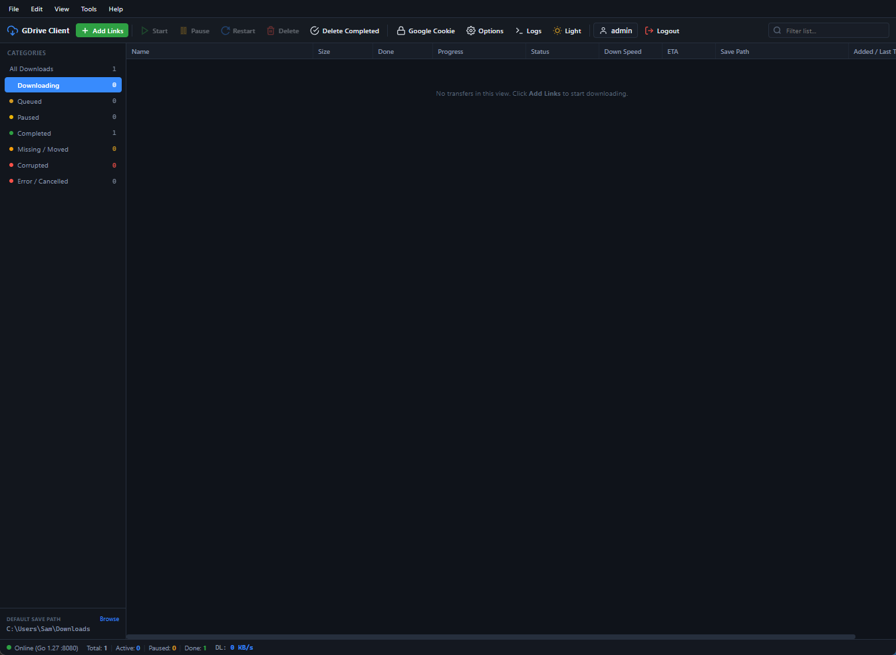
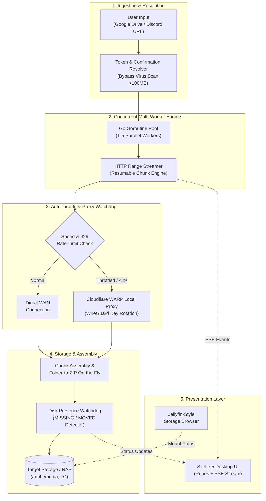

<div align="center">

# Google Drive Downloader (GDDL)

### Desktop Web Edition with Anti-Throttle WARP Proxy

A high-performance, self-hosted desktop & server download manager for Google Drive and Discord CDN. Features a concurrent Go engine, Svelte 5 (Runes) UI, qBittorrent/IDM layout, automated Cloudflare WARP anti-throttling, folder-to-ZIP compression, and external storage auto-discovery.

[](https://golang.org)
[-FF3E00?style=flat-square&logo=svelte)](https://svelte.dev)
[](https://vitejs.dev)
[](https://www.docker.com)
[](https://developers.cloudflare.com/warp-client/)
[](LICENSE)

[Quick start](#quick-start) · [Architecture](#download-pipeline--architecture) · [Features](#core-features) · [Server deployment](#server-deployment--docker-compose) · [Configuration](#configuration-reference) · [Troubleshooting](#troubleshooting)

</div>

---

> Built for power downloaders and homelab operators: an industrial-grade download manager that bypasses Google Drive virus scan prompts, handles 429 CDN rate limits with automatic WARP key rotation, and downloads straight to NAS mounts.

---

## Preview

| Active Transfers & Real-Time Monitoring | Clean Dashboard & Category Filter |
|---|---|
|  |  |

---

## Download Pipeline & Architecture



---

## Core Features

<table>
  <tr>
    <td width="50%" valign="top">
      <h4>⚡ Download Engine & Anti-Throttling</h4>
      <ul>
        <li><strong>Google Drive & Discord CDN Support</strong>: Parallel downloads with Range-request resume and Discord expiry checks.</li>
        <li><strong>Anti-Throttle WARP Watchdog</strong>: Auto-rotates WireGuard keys and switches to local SOCKS5 proxy when throttled.</li>
        <li><strong>Large File Virus Scan Bypass</strong>: Automatically resolves confirmation tokens for &gt;100MB Google Drive files.</li>
        <li><strong>Folder-to-ZIP Compression</strong>: Compresses Google Drive folders directly into verified <code>.zip</code> archives on the fly.</li>
        <li><strong>Real-Time Disk Sync</strong>: Marks moved or deleted files as <code>MISSING/MOVED</code> with 1-click re-download recovery.</li>
      </ul>
    </td>
    <td width="50%" valign="top">
      <h4>🖥️ Desktop UI & Server Deployment</h4>
      <ul>
        <li><strong>qBittorrent / IDM Interface</strong>: Desktop-grade transfer grid built with reactive Svelte 5 Runes.</li>
        <li><strong>Jellyfin-Style Storage Browser</strong>: Auto-discovers external hard drives and mount points (<code>/mnt</code>, <code>/media</code>, <code>D:\</code>).</li>
        <li><strong>Google Cookie Session Support</strong>: Paste session cookies to download quota-exceeded or restricted team drive files.</li>
        <li><strong>Server-Ready Authentication</strong>: Built-in web login protection via <code>AUTH_ENABLED</code>, <code>AUTH_USER</code>, and <code>AUTH_PASS</code>.</li>
        <li><strong>Desktop Keybindings</strong>: Full keyboard control (<kbd>Ctrl+N</kbd> add, <kbd>Del</kbd> remove, <kbd>Space</kbd> toggle, <kbd>Ctrl+A</kbd> select).</li>
      </ul>
    </td>
  </tr>
</table>

---

## Tech Stack Matrix

| Layer | Technology | Purpose |
|---|---|---|
| **Backend Core** | Go 1.22+ | Lightweight concurrent worker pool, SSE server, and file stream router |
| **Frontend UI** | Svelte 5 (Runes) + Vite 6 | Reactive qBittorrent-style desktop web interface and real-time state |
| **Styling** | Tailwind CSS | Modern responsive dark theme and utility layout |
| **Anti-Throttle Engine** | Cloudflare WARP / WireGuard | Local SOCKS5 proxy with automated WireGuard key rotation upon 429 |
| **Containerization** | Docker Compose (`NET_ADMIN`) | Isolated deployment with `/dev/net/tun` network capabilities |

---

## Quick Start

### Prerequisites
- **Go 1.22+** (for building backend from source)
- **Node.js 20+** & **npm** (for building frontend)
- Or simply run the pre-compiled binary.

### Run Pre-Compiled Binary

```bash
# Windows
.\gddl.exe

# Linux / macOS
./gddl
```

The Web UI will be available at `http://localhost:8080`.

### Build from Source

```bash
# 1. Build the Svelte 5 frontend
cd frontend
npm install
npm run build

# 2. Compile the Go backend
cd ../backend
go build -o gddl .

# 3. Launch the application
./gddl
```

---

## Server Deployment & Docker Compose

Deploy on a headless server, VPS, or NAS with automatic Cloudflare WARP anti-throttling privileges:

```yaml
version: '3.8'

services:
  gddl:
    image: gddl:latest
    build: .
    container_name: gddl
    restart: unless-stopped
    ports:
      - "8080:8080"
    cap_add:
      - NET_ADMIN
    devices:
      - /dev/net/tun:/dev/net/tun
    sysctls:
      - net.ipv6.conf.all.disable_ipv6=0
    environment:
      - PORT=8080
      - HOST=0.0.0.0
      - DOWNLOAD_DIR=/downloads
      - CONFIG_DIR=/config
      - AUTH_ENABLED=true
      - AUTH_USER=admin
      - AUTH_PASS=adminadmin
      # Optional: extra paths for the storage browser
      # - EXTRA_DRIVES=/mnt/storage,/mnt/nas
    volumes:
      - ./config:/config
      - ./downloads:/downloads
      - ./warp:/var/lib/cloudflare-warp
      # External storage mounts:
      # - /mnt/storage:/mnt/storage:rw
```

Start the service:

```bash
docker compose up -d
```

> [!NOTE]
> `cap_add: [NET_ADMIN]` and `/dev/net/tun` are required for `warp-svc` inside the container. In unprivileged LXC (e.g. Proxmox), enable `nesting=1,keyctl=1` and pass through `/dev/net/tun`.

---

## Configuration Reference

Configure via command-line flags or environment variables:

| Flag | Environment Variable | Default | Description |
|---|---|---|---|
| `-port` | `PORT` | `8080` | Port to bind the HTTP server. |
| `-host` | `HOST` | `0.0.0.0` | IP address to bind to (`0.0.0.0` allows LAN/remote access). |
| `-dir` | `DOWNLOAD_DIR` | `~/Downloads` | Default download directory for incoming files and ZIPs. |
| `-config` | `CONFIG_DIR` | `.` | Directory where `config.json` and `downloads.json` are stored. |
| `-auth` | `AUTH_ENABLED` | `true` | Enable or disable Web UI authentication. |
| `-user` | `AUTH_USER` | `admin` | Initial admin username for Web UI. |
| `-pass` | `AUTH_PASS` | `adminadmin` | Initial admin password for Web UI. |
| — | `EXTRA_DRIVES` | `""` | Comma-separated paths for the storage browser (`/mnt/hdd,/media/usb`). |

---

## Troubleshooting

| Symptom | Probable Cause | Immediate Remediation |
|---|---|---|
| **WARP Connection Error** | Missing `NET_ADMIN` or `/dev/net/tun` permissions | Verify Docker compose has `cap_add: [NET_ADMIN]` and `/dev/net/tun` mounted. Alternatively, configure a custom SOCKS5/HTTP proxy pool in Settings. |
| **Download Quota Exceeded** | Google Drive public quota exhausted | Export and paste your Google session cookie (`authuser`, `HSID`, `SSID`, `SID`) via **Tools > Google Cookie** in the Web UI. |
| **Discord CDN 403 / Expired** | Discord attachment URL `ex` timestamp expired | Refresh the attachment URL from Discord and re-add. GDDL pre-validates expiry timestamps to save bandwidth. |
| **Moved / Missing Files** | Downloaded file was moved or deleted from disk | GDDL marks missing items as `MISSING/MOVED`. Click the **Re-download** button to fetch the file again. |

---

## Documentation & Repository Index

| Document | Purpose | Target Audience |
|---|---|---|
| [docker-compose.yml](docker-compose.yml) | Production container orchestration with Cloudflare WARP and storage volumes | Homelab Operators & DevOps |
| [config.json](config.json) | Local client runtime state, concurrency, and proxy configuration | Power Users & Administrators |
| [TODO.md](TODO.md) | Roadmap, upcoming feature milestones, and backlog tracking | Contributors & Developers |

---

## License

Distributed under the [MIT License](LICENSE).

<div align="center">
<sub><a href="#google-drive-downloader-gddl">Back to top ↑</a></sub>
</div>
